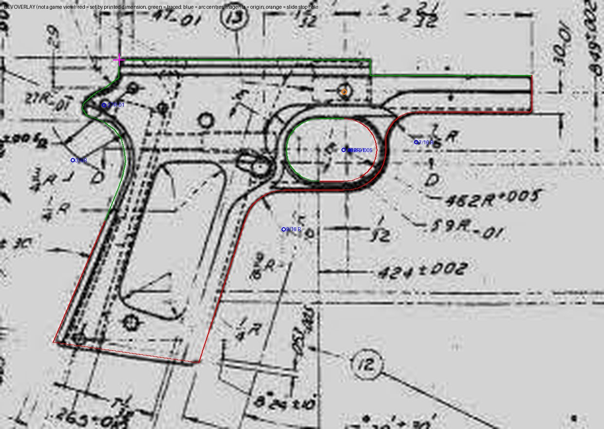
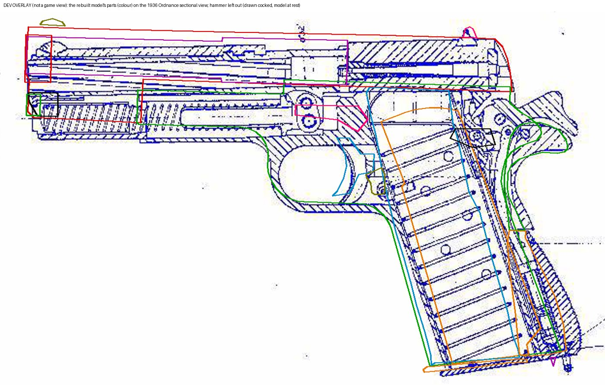
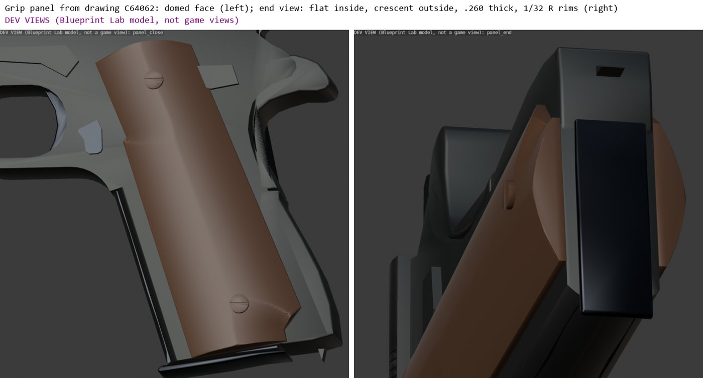
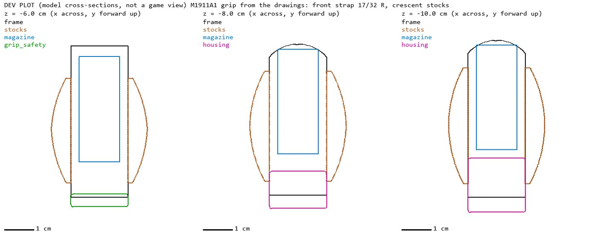
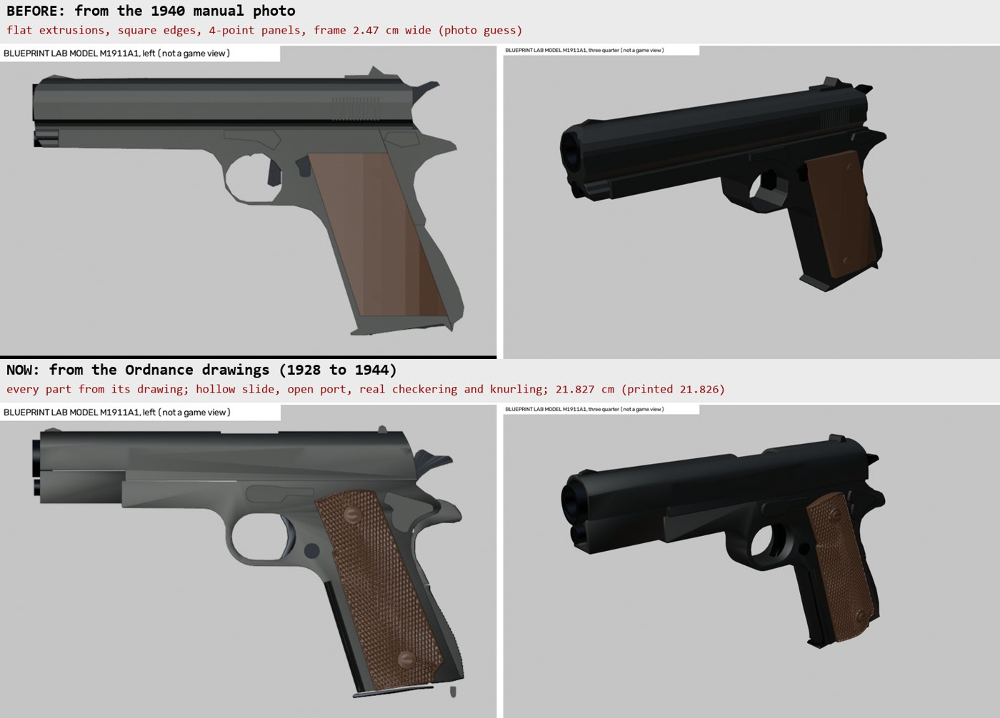

# Blueprint Lab

Blueprint Lab makes a real gun's visual copy from its public sources: manuals, patents and photos. It is steps 1 to 6
of the gun digitizer (docs/DIGITIZE.md). Gun Kit then rigs the model and makes its clips (docs/GUNKIT.md).

Claude reads the pages, picks the figures and names the parts. The tools take every number, and every number in the
blueprint names its source.

## The steps

| Step | Tools | What it does |
|---|---|---|
| 1. Sources | `blueprint_source_add`, `blueprint_scan`, `blueprint_page`, `blueprint_text` | registers a file with its license, sorts its pages (text, table, figure), draws pages to read |
| 2. Facts | `blueprint_specs`, `blueprint_fact_add` | finds the data table's quantities, records each one in cm or kg with its page and quote |
| 3. Figures | `blueprint_figure_add`, `blueprint_grid`, `blueprint_calibrate`, `blueprint_frame`, `blueprint_align` | cuts a figure from a page, stands it upright, scales it, places it in gun space |
| 3. Readings | `blueprint_trace`, `blueprint_measure` | outlines (silhouette, region, snap, blob), ink spans, scale bar ticks, faint marks' count and pitch (peaks), distances |
| 4. Blueprint | `blueprint_new`, `blueprint_part`, `blueprint_hole`, `blueprint_mark`, `blueprint_read` | writes the parts (extrude or lathe, clipped where neighbours meet), cuts, marks |
| Detail | `blueprint_views`, `blueprint_feature`, `blueprint_parts_list`, `blueprint_numbers` | shapes parts by three views, adds grooves, screws and textures, holds every visible listed part to a blueprint part |
| 5. Check | `blueprint_check` | contract, outline overlap with the reference, length and weight sums, overlay pictures |
| 6. Model | `blueprint_build`, `blueprint_showcase` | the model in Blender, one object a part, its parts map, labelled pictures; a GIF and MP4 showcase |
| 7. Motion | `blueprint_to_gunkit` | Gun Kit: rig, hand clips, gun clips, read-back |

A gun's files are in `<work>/digitize/<gun>/` (or under `WEAPONLAB_DIGITIZE`): `sources.json`, `blueprint.json`,
`pages/`, `figures/`, `check/`, `model/`.

## Scale and frame

A figure needs a scale (cm a pixel) and a frame (the bore line and the bolt face) before its outlines turn into gun
space. There are three ways to get them:

- **Two points a known length apart:** a printed scale bar's first and last ticks (`blueprint_measure` with
  `ticks` finds them), or two ends of a fact.
- **An outline's length along the bore:** against the overall length fact (`blueprint_calibrate` with
  `extent_of`).
- **A shared part:** a part both figures show, matched to a figure that is already framed (`blueprint_align`). A
  trigger guard's opening works well: it is fixed to the frame and drawn in most views.

The bore line comes from a fact where one exists. For example, the front sight's height above the bore puts the
bore under the traced sight. The bolt face is the muzzle less the barrel's length.

## What a part is

- **extrude:** a side outline in (y, z), run across x from the gun's right (x0) to its left (x1). Clips cut the
  outline where a neighbour starts. A clip is a level line (`y` or `z`) or any line (`line`), and each says why.
- **lathe:** a profile (y, r) turned round a line parallel to the bore, with an optional bore along it.
- **views:** a side outline cut against front sections and a top outline: a part whose width changes.
- **relief:** a side outline with a flat inner face and an outer face arched across its width, from `edge_cm` at the
  rim to full thickness in the middle (`both` makes the mirrored pair). Grip panels, as their drawing's sections show.
- **outline corners:** any outline point may carry a third number, the drawing's corner radius in cm. The corner
  becomes a true arc tangent to both edges.
- **holes:** an outline or a circle cut across x (limited to part of x when given), a bore along y, or a `sweep`: a
  cross-section in (u, x) swept along a slanted side-view line, to shape a face along an edge (a front strap's round).
- **bevel_cm:** the part's edges rounded (an arc, one segment every 0.02 cm of radius), the round faces shaded smooth.
- **knurl (feature):** real knurling or checkering pressed into a face as 90 degree V grooves: diamond or straight, its
  pitch, angle, turn, depth, a plain border and plain round bosses. The face's mesh is refined to a quarter pitch.
- **crown (feature):** a face curved across the part's width to a printed radius (a grip safety's palm face, a
  housing's back), the knurl following it.

A part's role is `body` or one of its action family's part roles. A moving part's motion is `slide`, `turn` or
`free`. An action may let a part move in more than one way. A pistol's trigger, for one, turns or slides
(`kinds` in the action file).

## The detail pass

A blueprint made from side outlines alone is the gun's silhouette: every part a slab. The detail pass makes it look
like the gun.

- **Three views.** `blueprint_views` turns a part into `views`: its side outline (y, z), front sections (x, z) over
  runs of y, and a top outline (y, x). The builder keeps what all three share, so a slide gets its rounded top from a
  front section and a stock its curve from a plan view.
- **Every visible part.** `blueprint_parts_list` records the source's parts, the labels on its sections, read off
  the figure, each marked visible or hidden, and why. Each blueprint part names the numbers it stands for
  (`blueprint_numbers`). A visible part with no blueprint part fails the check. A part the text names without a
  number matches by its name.
- **Surface features.** `blueprint_feature`:
  - `grooves` (serrations): cut into a face, counted and spaced from the figure (`blueprint_measure` with `peaks`).
  - `screw`: a head standing on a face, slotted.
  - `texture` (checkering, knurling, stippling, markings): too fine for the mesh, so it goes to the finish. The build
    lists them in `build.json`.

The check's `detail` result gives the listed and visible parts, the missing ones, how many parts are shaped, slabs
or round, and the features by kind.

## Edge noise

A photo printed as a halftone, or a grainy scan, gives a traced outline a chipped edge: the tracer follows the dots.
`blueprint_trace` with `smooth_px` takes it out. It finds the outline's corners (turns of `corner_deg` or more, judged
over twice the window), averages each run between two corners over the window with its corner ends held, then
simplifies. Straight edges come out straight, curves even, corners sharp. The trace records the smoothing, and every
part cut from it says so in its source. The M1911A1 uses 13 px and 40 degrees (0.38 cm and its corners).

## Showcase

`blueprint_showcase` makes a labelled GIF and MP4 of a gun that has been through Gun Kit:

- a title card
- the source figure beside the copy
- one turn round the gun
- its own clips: firing slowed down, the empty reload, the chamber check, the magazine check

The MP4 is H.264 from Blender's encoder, so no ffmpeg is needed. The files are in `<gun>/showcase/`.

## Checks

| Check | Pass |
|---|---|
| contract | no problems: every number has a source, every role fits the action |
| detail | every visible part in the source's parts list has a blueprint part |
| outline | IoU at least 0.95 and a mean edge gap at most 0.15 cm against the reference silhouette |
| length | within 1 percent of the overall length fact |
| weight | warns only: the copy is solid where the gun is hollow |

## From engineering drawings

When the gun's own drawings exist, Blueprint Lab builds from them, not from a photo. The M1911A1 now comes from the
Ordnance Department's sheets (1936, revised to 1944): the receiver D35359, the stocks C64062, the barrel, hammer and
trigger, and the two sectional views.

How the drawings become a blueprint (`digitize/M1911A1/drawings/to_blueprint.py`):

1. **Read the numbers.** Each sheet is read in zoomed crops: every printed value with its view and a confidence.
2. **Build outlines like a CAD sketch.** The frame's side outline takes 34 of its 52 points from printed dimensions,
   the rest traced. Its printed radii (the guard's .462 and .59, the 9/16 and 7/16 fillets) are true arcs.

3. **One assembly layout.** Every part is traced on the sectional view at the sheet's own scale bar. Each part's
   exact outline is fitted onto it (rotation and shift, least squares on nearest points).
4. **Gun space.** cm, with y = 0 at the breech face and z = 0 on the bore, the muzzle at the barrel's printed length.
5. **Check against the sources.** Every part is drawn back on the drawing. The length is checked against the
   manual's printed overall length: 21.824 cm against 21.826 cm.

What the new shapes give:

- **Curved panels:** the stocks are .260 in thick in the middle and thin to 1/32 in rims, flat inside, as C64062's
  sections show.

- **Real cross-sections:** a slice through the grip shows the crescent stocks on both sides and the front strap's
  17/32 in round across the .762 in frame.

- **No sharp edge where a hand holds:** every hand-contact edge is rounded, from the drawing or by at least 0.75 mm
  (MIL-STD-1472G 5.7.7.6).

What the drawings do not give, so far:

- the slide, grip safety, housing and magazine have no drawing of their own in the set: they are traced from the
  section view (good to about 0.03 to 0.07 in), their widths reasoned;
- the thumb safety, slide stop, magazine catch and lanyard loop keep their photo shapes, placed on the drawing's pins;
- where the scan and a printed value disagree (the lower stock screw hole, 0.25 in apart), the part's own printed
  value decides and the conflict is recorded.

## The worked example: M1911A1

`examples/m1911a1/sources.py`, `blueprint.py` and `detail.py` build the M1911A1 from FM 23-35 (War Department, 1940).

| Source in the manual | Used for |
|---|---|
| General data table (page 8) | overall length 8.593 in, front sight 0.5597 in above the bore, barrel 5.03 in, bore 0.45 in, weights |
| Figure 2, photo (page 7) | the outline, scaled by the overall length; the trigger guard's opening |
| Figure 3, section (page 12) | the slide's lower edge (as a share of its height), the slide's travel (drawn locked back), the magazine tube |
| Top of Figure 3 (page 11) | the slide's and the stocks' widths (as shares) |

Result (2026-10-16):

- **Blueprint:** 6 parts (slide, frame, hammer and grip safety, stocks, barrel, magazine), 12 marks.
- **Outline:** IoU 0.997 against the photo, mean edge gap 0.005 cm, worst 0.17 cm.
- **Readings:**
  - slide travel 4.75 cm
  - slide 2.43 cm wide
  - grip 3.29 cm across the stocks
- **Gun Kit:** every gun clip reads back within 0.0005 cm.

After the detail pass (`detail.py`):

- **Blueprint:** 18 parts. The new ones are the sights, the slide's front lobe, the hammer, the grip safety, the
  mainspring housing, the lanyard loop, the trigger, the magazine catch, the slide stop, the thumb safety, the
  bushing and the recoil spring plug.
- **Parts list:** 43 parts read off the sections and the text, 20 of them visible, all 20 in the blueprint.
- **Shaped parts:**
  - the slide: its rounded top from section A-A
  - the stocks: their curve from the plan view
- **Features:**
  - 14 rear serrations at 0.176 cm (counted on the photo)
  - two screws on each stock
  - checkering on the stocks and the magazine catch
  - knurling on the trigger and the mainspring housing (from the text)
- **Outline:** IoU 0.991 against the photo.

Still slabs: the frame, the magazine and the small parts (no front or top view shows them). The traced edges are
smoothed (edge noise, above).

What the example found about its sources:

- **The figures disagree.** Small features differ by 5 to 10 percent between the photo, the section and the
  section's own printed scale bar. The copy takes outer shapes from the photo (scaled by a printed fact) and only
  shares from the sections.
- **The section draws the slide locked back.** That gives the slide's travel, and its y readings are of the open
  slide.
- **The photo is solid black inside its outline.** The line between the slide and the frame does not show, so the
  slide's lower edge comes from the section.
- **Guesses** (each in the blueprint with its reason):
  - the ejection port's size
  - the magazine's width
  - the hammer's width
  - the stocks' top and bottom
  - the magazine catch's and the slide stop's places

## Next: soft edges where a hand holds

The owner, 2026-10-21: "the grip is no sharp edge, this will be the next improvement for Model Lab when read on the
manual or images, make the corner round a bit, especially the places that human grab and hold, most of the time they
will no sharp edge because sharp edges will hurt the hand/human, make them softer so hand can hold it".

What it means for a build:

- **Hand-contact parts get rounded edges.** The grip and every part a hand grabs or holds: the stocks (grip panels),
  the grip safety, the mainspring housing, the front strap, the trigger guard, the magazine base. A real gun has no
  sharp edge there, because a sharp edge hurts the hand.
- **The round comes from a source, not a guess.** Read it from the manual or the part drawing when one shows it.
  Otherwise use a human-engineering source for hand-contact edges, and record which one in the part's sources.
- **Found by the hold.** On the M1911A1, the grip safety is a straight extrusion with square edges. Its left lower
  edge pressed 0.42 cm into the firing palm (the palm gives 0.27 cm). The palm check found it (Pose Lab
  walls_of, Step 2).
- **Today:** `bevel_cm` rounds a part's edges (a Blender bevel). Only the frame has one (0.08 cm, marked a guess).

## Requirements

`pip install weaponlab-mcp[blueprint]` adds PyMuPDF (PDF pages) and OpenCV (tracing). The build and Gun Kit need
Blender (`WEAPONLAB_BLENDER`, or Blender on the PATH).
